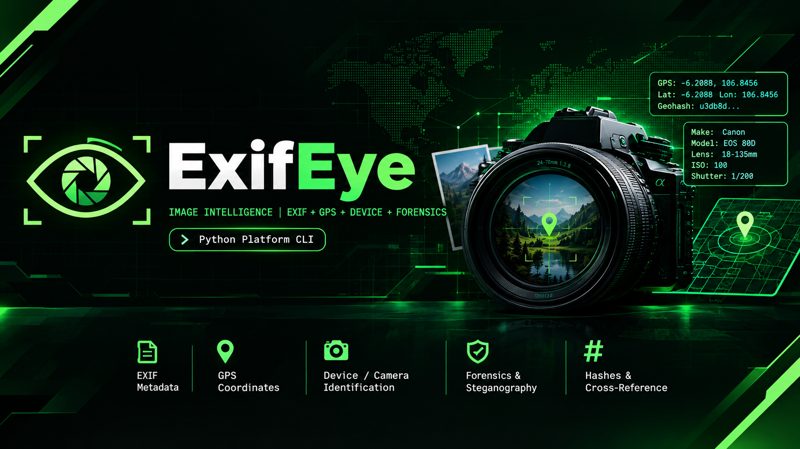

<p align="center">
  
</p>

# ExifEye

**IMAGE INTELLIGENCE | EXIF + GPS + DEVICE + FORENSICS**

[](https://www.python.org/downloads/)
[](#requirements)
[](#usage)

An OSINT command-line tool that mines a single image — or a whole folder — for
every trace a camera or phone leaves behind: EXIF metadata, embedded GPS
coordinates, device/camera identification, editing and steganography
forensics, platform re-encoding fingerprints, and cryptographic hashes for
cross-referencing.

> **Legal note:** the target image does **not** need to be inside this folder.
> Point the tool at any path — absolute or relative — from anywhere on disk.

---

## Table of Contents

- [Features](#features)
- [Supported Formats](#supported-formats)
- [Requirements](#requirements)
- [Installation](#installation)
- [Usage](#usage)
- [Options](#options)
- [Report Sections](#report-sections)
- [Custom Device Database](#custom-device-database)
- [How It Works](#how-it-works)
- [Testing](#testing)
- [Disclaimer](#disclaimer)

---

## Features

- **EXIF metadata extraction** — make, model, lens, focal length, aperture,
  shutter speed, ISO, timestamps (taken / digitized / modified), software,
  serial numbers, unique image IDs, and more.
- **GPS geolocation** — decodes EXIF GPS tags, converts to decimal degrees,
  derives a [geohash](https://en.wikipedia.org/wiki/Geohash), and prints a
  one-click Google Maps link.
- **XMP GPS recovery** — when EXIF has been stripped but a residual XMP
  description survives (common with Google Camera / Photosphere pipelines),
  coordinates are recovered from the XMP block and reported as
  *"XMP residual metadata (recovered)"*.
- **Device / camera identification** — pattern-driven brand and device-type
  recognition (smartphone, camera, drone, action cam, webcam) that works even
  for brand-new models. Raw `Make` / `Model` values are always preserved.
- **OS / platform detection** — reads the `Software` tag to detect Android,
  iOS, macOS, Windows, MIUI, One UI, etc.
- **Device enrichment database** — an editable JSON file adds friendly model
  names and release years without ever overriding raw values.
- **Social media forensics** — analyzes re-encoding artifacts, JPEG
  structure, platform signature strings, dimension heuristics and text
  artifacts to suggest which platform an image may have traveled through.
- **WhatsApp filename detection** — WhatsApp media files follow the
  `IMG-YYYYMMDD-WA####.jpg` pattern; the received date is extracted
  automatically (`IMG-20230415-WA0001.jpg` -> `2023-04-15`).
- **Deep forensics** — Error Level Analysis (ELA) to spot edited regions,
  basic LSB steganography detection, and image entropy analysis.
- **Exports** — JSON and standalone HTML reports, with GPS rendered on an
  embedded map in the HTML version.
- **Hacker-green theme** — Matrix-style output: bright green accents, lime
  warnings, red reserved for risks only.
- **Batch + recursive scans**, quiet mode, granular feature toggles, and an
  interactive prompt when run without arguments.

---

## Supported Formats

```
.jpg  .jpeg  .jfif  .png  .gif  .webp  .bmp  .tif  .tiff
.heic  .heif  .cr2  .nef  .arw  .raw
```

Unsupported files are skipped with a notice; missing paths are reported
without aborting the batch.

---

## Requirements

- Python **3.10+**
- Dependencies (install via `requirements.txt`):

```
exifread>=3.0.0
Pillow>=10.0.0
rich>=13.0.0
click>=8.1.0
imagehash>=4.3.0
numpy>=1.24.0
defusedxml>=0.7.1
```

`defusedxml` enables Pillow's `getxmp()` XMP reading.

---

## Installation

**Windows** — double-click `install.bat` (or run it in a terminal). It
installs dependencies, registers the global `exifeye` command, and adds it to
your PATH automatically.

**Linux / macOS** — use the manual setup below (no shell installer is bundled).

**Manual / custom setup:**

```bash
cd ExifEye
pip install -r requirements.txt
pip install -e .        # creates the global `exifeye` command
```

`pip install -e .` reads `pyproject.toml` and installs an entry point, so
`exifeye` becomes callable from any directory. The default device database
ships inside the package.

`start.bat` is the single Windows launcher: it tries the global `exifeye`
command first and falls back to `py exifeye.py`. Use it only if `exifeye`
isn't on your PATH yet — the global command is the primary way to run the tool.

> **Tip — `exifeye` not found?** On Windows the command lives in your Python
> **Scripts** folder. If it isn't recognized after installing, the terminal
> was almost certainly **open before** the install — PATH changes only reach
> newly-opened windows. Close and reopen your terminal (or start a new tab).
>
> This matters most in **Git Bash / MINGW64 / MSYS**: a bash session snapshots
> its PATH at startup and won't see the new `Scripts` folder. Open a **new Git
> Bash window** and it will work. `install.bat` registers the PATH at the
> Windows user level for cmd / PowerShell / Windows Terminal.

---

## Usage

```bash
exifeye <file-or-folder> [options]
```

The target can be **anywhere on disk** — it does not need to live inside the
project folder. Absolute or relative paths both work:

```bash
exifeye "D:\photos\IMG_0001.jpg"   # a single file anywhere
exifeye ..\downloads --recursive   # a folder anywhere
```

Run without arguments to enter the interactive prompt and pick an image or
folder:

```bash
exifeye
```

### Examples

Analyze a single image:

```bash
exifeye photo.jpg
```

Analyze several images at once:

```bash
exifeye photo1.jpg photo2.jpg photo3.png
```

Scan a whole folder recursively:

```bash
exifeye ./photos --recursive
```

Export JSON + HTML reports into a folder:

```bash
exifeye photo.jpg --json --html --output-dir ./reports
```

Quiet mode — only the one-line summary per image:

```bash
exifeye ./photos --recursive --quiet
```

Use a custom device database:

```bash
exifeye photo.jpg --device-db ./my_devices.json
```

---

## Options

| Option | Description |
| --- | --- |
| `-r, --recursive` | Scan directories recursively |
| `--json` | Export a JSON report per image |
| `--html` | Export a standalone HTML report per image |
| `--output-dir DIR` | Directory for exported reports (default: image folder) |
| `--no-hashes` | Skip file hash calculation (MD5/SHA-1/SHA-256) |
| `--no-deep` | Skip deep forensics (ELA, steganography) |
| `--no-social` | Skip social media forensics |
| `-q, --quiet` | Print only the one-line summary, not the full report |
| `--device-db FILE` | Path to a custom device enrichment JSON database |
| `-h, --help` | Show all options |

---

## Report Sections

For every image the tool prints:

1. **General information** — format, dimensions, color mode, DPI, orientation,
   ICC profile, file size.
2. **EXIF core** — camera settings, lens, timestamps, software, serials.
3. **GPS coordinates** — `GEOLOCATED` / `NO GPS DATA` status, decimal
   coordinates, geohash, Google Maps link.
4. **Device / Camera** — brand, make, model, device type, OS, enrichment data,
   lens and serial information.
5. **Deep forensics** — ELA error-level analysis, steganography and entropy
   checks.
6. **Social media** — platform fingerprint from re-encoding, artifacts and
   WhatsApp filename patterns.
7. **Hashes** — MD5, SHA-1, SHA-256 for file matching across datasets.

A **forensic score (0–10)** summarizes the findings, and when GPS is missing a
**reverse image search** footer (Google Lens / Yandex / TinEye / Bing Visual)
points to finding a copy of the image that kept its coordinates — the
practical path to geolocating a stripped image.

---

## Custom Device Database

`--device-db` replaces the bundled enrichment file. Keys are the raw
`Make` / `Model` strings (case-insensitive); lookups are best-effort and never
override raw EXIF values. Example:

```json
{
  "NIKON CORPORATION": {
    "model_name": "Nikon D3000",
    "brand": "Nikon",
    "device_type": "Camera",
    "year": 2009
  }
}
```

Brand / device-type classification itself is regex-driven and does **not**
need a database entry — a never-seen `iPhone 30` or `SM-Z999` is still
classified correctly.

---

## How It Works

```
exifeye.py                  entry point, click CLI with options
pyproject.toml              packaging + global `exifeye` command entry point
install.bat                 one-command setup (deps + command + PATH)
start.bat                   Windows launcher (tries `exifeye`, falls back to `py exifeye.py`)
extractor/core.py           tag extraction, hashes, timestamps, general info, XMP GPS
extractor/gps.py            GPS tag decoding, coordinate math, geohash
extractor/device.py         regex classification + enrichment database
extractor/device_db.json    bundled device enrichment data
analyzers/social_media.py   platform re-encoding / WhatsApp filename analysis
analyzers/deep_forensics.py ELA + steganography checks
output/console.py           rich console rendering (+ toolbar banner)
output/json_export.py       JSON report export
output/html_report.py       standalone HTML report export (map for GPS)
```

All exports use sanitized, URI-safe filenames; HTML reports HTML-escape every
EXIF-derived value to prevent XSS; JSON exports reject invalid image files
gracefully instead of crashing.

---

## Testing

A smoke-test corpus (real camera images with GPS, an EXIF-stripped copy, an
XMP-only GPS file, a WhatsApp-named file, and corrupt/empty edges) is kept
outside the project tree:

```bash
exifeye <corpus-dir> --recursive --json --html --output-dir <reports-dir>
```

Reference samples are downloadable from the public
[ianare/exif-samples](https://github.com/ianare/exif-samples) repository
(`jpg/gps/DSCN0010.jpg`, `jpg/Nikon_COOLPIX_P1.jpg`,
`jpg/Olympus_C8080WZ.jpg`).

---

## Disclaimer

ExifEye is an OSINT / digital-forensics **learning tool**. Use it only on
images you own or have permission to analyze. Embedded GPS coordinates and
device serials are sensitive information — stripping this metadata (or not
uploading originals) is the only reliable way to keep it private. The tool
detects traces; it cannot reliably "prove" the origin of a heavily re-encoded
image.